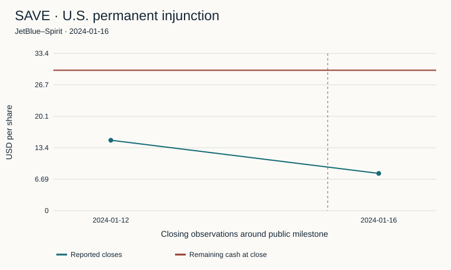
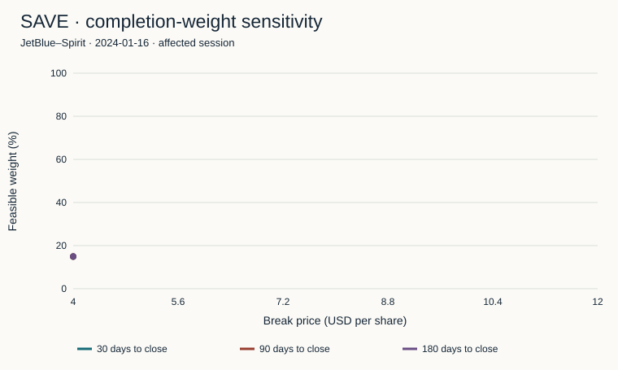

# Merger Spread Lab

Three U.S. cash deals illustrate how stocks traded across regulatory milestones. At the injunction against JetBlue’s purchase, Spirit’s close fell from $14.97 to $7.92. The market-adjusted move was −46.72 percentage points. Only three of the nine post-event recovery and timing scenarios gave feasible completion weights, versus all nine before the ruling.





The [results memo](RESULTS.md) reports the completed Activision and failed iRobot cases. The [scope](SOURCES.md) is six reported closes and three one-session market comparisons. The scenario grid is illustrative, with date-specific offer cash flows.

## Reproduce

Use Python 3.11 or newer. No external packages are required.

```sh
git clone https://github.com/NeilMeher/merger-spread-lab.git
cd merger-spread-lab
python -m unittest -v
python study.py --fixture --output fixture
python study.py
```

The study regenerates timeline and sensitivity charts for each deal and [weights.csv](report/weights.csv). To import other audited observations, supply a CSV matching [events.csv](events.csv) via `--input`. The built-in future prepayment rule is specific to the listed January 2024 Spirit case. Extending that case requires a dated payment ledger.

Neil Meher commissioned the study and set the research and verification requirements. Codex assembled the event records, built the scenario model, and ran the checks. Neil’s manual review is pending.
